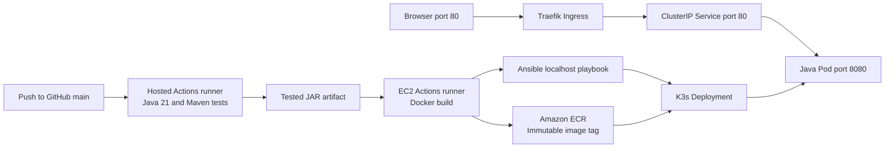

# Deployment operations

## Architecture



## Existing resources

| Resource | Value |
|---|---|
| AWS region | ap-southeast-2, Sydney |
| EC2 | i-009c142441c60c7a8 / final_lab_server |
| OS and size | Ubuntu 24.04, x86_64, t3.small, 20 GiB root volume |
| Instance role | final-lab-ec2-role |
| ECR | 656972167295.dkr.ecr.ap-southeast-2.amazonaws.com/final-lab |
| Namespace | final-lab |
| Deployment, Service, Ingress | final-lab |
| Runner | final-lab-ec2, label final-lab-deploy |
| Runner service | actions.runner.MohithR2005-devops_final_lab.final-lab-ec2.service |
| Credential timer | final-lab-ecr-refresh.timer |

## What persists

K3s, Docker, the Actions runner and the renewal timer are installed as system services. Closing the browser, disconnecting SSH or turning off the laptop does not stop them. No daily reinstall is required. EC2 must remain running for the application and deployment job to work. Tasks are in memory and do not survive a pod restart.

## Server bootstrap record

Ubuntu was provisioned in EC2, K3s installed and the EC2 instance profile attached. AWS CLI, Docker and Ansible were installed. The official GitHub runner release archive was checked against its GitHub-provided SHA256 digest, registered to this repository using a short-lived registration token, and installed as a systemd service under final-lab-runner. This account has Docker group membership and passwordless sudo for the assignment's deployment playbook.

The role retains AmazonSSMManagedInstanceCore and AmazonEC2ContainerRegistryReadOnly. An inline FinalLabEcrPublish policy grants BatchCheckLayerAvailability, InitiateLayerUpload, UploadLayerPart, CompleteLayerUpload and PutImage only on the final-lab repository. It does not grant deletion, IAM administration or access to other ECR repositories.

Systems Manager was used for setup and inspection. Routine GitHub deployment runs directly on the EC2 runner and does not use SSH or SSM commands.

## Deployment files

- `.github/workflows/ci-cd.yml`: triggers, hosted build/test, JAR artifact, dependent deploy and health/version verification.
- `Dockerfile`: reproducible local source build with tests and separate Java runtime stage.
- `Dockerfile.runtime`: lightweight pipeline image from the tested JAR.
- `ansible/inventory.ini`: localhost managed through the local connection plugin.
- `ansible/deploy.yml`: desired server configuration, rendered Kubernetes manifest and deployment verification.
- `scripts/refresh-ecr.sh`: generates the Kubernetes image-pull Secret through standard input without printing the token.
- `k8s/namespace.yaml`: namespace boundary.
- `k8s/final-lab.yaml`: one-replica Deployment, resource limits, probes, Service and Ingress.

## Troubleshoot or recover

```bash
sudo systemctl status k3s --no-pager
sudo systemctl status actions.runner.MohithR2005-devops_final_lab.final-lab-ec2 --no-pager
sudo systemctl list-timers final-lab-ecr-refresh.timer
sudo kubectl get pods -n final-lab
sudo kubectl describe pods -n final-lab
sudo kubectl logs deployment/final-lab -n final-lab --tail=80
df -h /
free -h
```

For image authentication failures, run `sudo systemctl start final-lab-ecr-refresh.service` and inspect its journal. For failed application changes, revert the bad commit in Git and push main, which creates a new tested release. In an emergency `sudo kubectl rollout undo deployment/final-lab -n final-lab` can restore the previous ReplicaSet, but follow up with a Git revert so the repository and live state agree. The pipeline reports failures; it does not automatically roll back.

Each deployment keeps image history. Monitor the 20 GiB disk and remove unused Docker images when needed; do not delete images currently used by the application. Docker's build cache older than 24 hours is pruned by the workflow. K3s has a separate containerd image store.

## Security and limits

The application is HTTP-only, has no login/CSRF protection and stores shared tasks in memory. Use only demo data. The cluster is a single node with one replica, so it is not highly available. Recreate updates briefly interrupt service. The runner is privileged; keep main-branch write access trusted and never execute untrusted pull-request code on it. HTTP port 80 is public; SSH port 22 should be limited to the current administrator IP. Kubernetes API port 6443 does not need public exposure for this workflow.

## References

- GitHub self-hosted runners: https://docs.github.com/en/actions/hosting-your-own-runners/managing-self-hosted-runners/about-self-hosted-runners
- ECR authentication: https://docs.aws.amazon.com/AmazonECR/latest/userguide/registry_auth.html
- K3s: https://docs.k3s.io/
- Ansible playbooks: https://docs.ansible.com/ansible/latest/playbook_guide/playbooks_intro.html
